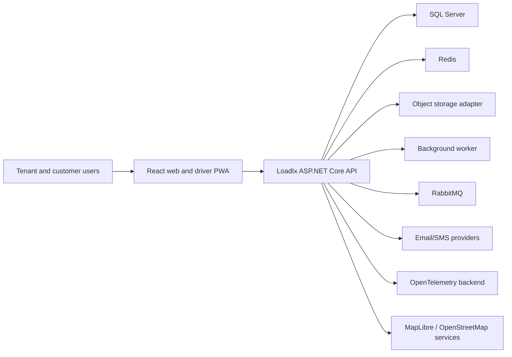
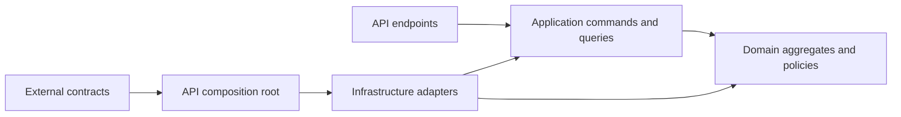

# LoadIx Architecture

## Status and Context

This document began as the architecture baseline for an empty repository.
Milestone 1 implements the documented five-project backend, React web shell,
local dependency environment, tests, and CI foundation. The core-domain
foundation adds tenant-aware EF Core persistence and synthetic master data.
Decisions that depend on operational discovery remain identified as provisional.

LoadIx will begin as a modular monolith: one backend deployable and one web/PWA
deployable, with internal module boundaries and durable integration patterns. This
keeps transactions and operations manageable for the MVP while preserving a
credible path to extract a module if scale or organizational ownership later
justifies it.

## System Context



RabbitMQ is not required for ordinary in-process module calls. It is reserved for
durable asynchronous integration, external consumers, and future service
extraction. The background worker handles scheduled/retriable application jobs. Their
responsibilities must not overlap accidentally.

## Recommended Repository Structure

```text
/
|-- AGENTS.md
|-- LoadIx.slnx
|-- Directory.Build.props
|-- Directory.Packages.props
|-- global.json
|-- .editorconfig
|-- .env.example
|-- compose.yaml
|-- docs/
|   |-- architecture.md
|   |-- product-scope.md
|   |-- domain-glossary.md
|   |-- development-workflow.md
|   |-- milestones.md
|   `-- decisions/
|-- src/
|   |-- LoadIx.Api/
|   |-- LoadIx.Application/
|   |-- LoadIx.Domain/
|   |-- LoadIx.Infrastructure/
|   `-- LoadIx.Contracts/
|-- tests/
|   |-- LoadIx.UnitTests/
|   |-- LoadIx.IntegrationTests/
|   `-- LoadIx.ArchitectureTests/
|-- apps/
|   `-- loadix-web/
|-- deploy/
|   |-- api.Dockerfile
|   |-- web.Dockerfile
|   |-- worker.Dockerfile
|   |-- migrations.Dockerfile
|   |-- nginx.conf.template
|   `-- Caddyfile.pilot
|-- compose.pilot.yaml
`-- .github/
    `-- workflows/
```

The proposed five backend projects are retained for the MVP. Creating one
assembly per business module now would add project overhead without yet proving a
need. Within `Domain`, `Application`, and `Infrastructure`, use matching
feature/module folders:

```text
Trips/
|-- Domain/
|-- Application/
`-- Infrastructure/
```

In practice, project roots provide the layer and folders provide the module, for
example `LoadIx.Domain/Trips`, `LoadIx.Application/Trips`, and
`LoadIx.Infrastructure/Trips`. Architecture tests enforce allowed references and
module-internal visibility. If module coupling becomes difficult to control,
promote selected modules to assemblies through an architecture decision.

## Logical Modules

| Module | Responsibilities |
| --- | --- |
| Identity & Access | Accounts, credentials, memberships, roles, permissions, sessions, support access |
| Tenancy | Tenant lifecycle, company profile, branches, settings |
| Customers | Customer records, customer-user access scope |
| Locations | Sites, addresses, coordinates, geofences |
| Fleet | Drivers, vehicles, trailers, availability and compliance metadata |
| Commercial | Commodities, contracts, rate and tolerance definitions |
| Instructions | Load instructions, planned quantity, fulfillment status |
| Trips | Planning, assignment, state machine, milestones, location observations |
| Weighing | Source/destination measurements, ticket metadata, net calculation |
| Reconciliation | Difference, tolerance result, review, approval |
| Documents | Metadata, upload lifecycle, access policy, retention linkage |
| Finance | Charge/cost snapshots, profitability, invoice-preparation batches |
| Notifications | Templates, preferences, delivery requests and outcomes |
| Audit | Append-only security, operational, and financial event records |

The operations board is a read model across Instructions, Trips, Fleet, Weighing,
and Reconciliation rather than a write-owning module.

## Dependency and Request Flow



- `LoadIx.Domain` has no dependencies on EF Core, ASP.NET Core, messaging, or
  storage packages.
- `LoadIx.Application` depends on Domain and declares ports such as current
  tenant/user, authorization, persistence/query, idempotency, object storage
  orchestration, and event publication.
- `LoadIx.Infrastructure` implements application ports and owns EF Core mappings,
  Identity, Redis, Hangfire, RabbitMQ, object storage, and provider adapters.
- `LoadIx.Api` is the composition root and HTTP/SignalR host.
- `LoadIx.Contracts` contains stable external request/event schemas where sharing
  is justified. Internal commands are not public contracts.

MediatR is optional rather than architectural. Start with explicit
command/query-handler interfaces and pipeline decorators. Add MediatR only if its
pipeline and dispatch value exceeds its dependency and indirection cost.

## Persistence

### SQL ownership

Use one SQL Server database for the modular monolith. Each table has a clear
owning module. Separate schemas per module are recommended (for example
`trips.Trips`, `finance.InvoiceBatches`) because they improve discoverability and
discourage accidental cross-module writes without adding operational databases.

Cross-module reads should use explicit query services or purpose-built read
models. Cross-module foreign keys are acceptable inside the monolith when they
protect essential integrity, but only the owning module mutates its records.

### Multi-tenancy

Use a shared database/shared schema tenancy model for the MVP, with `TenantId` on
every business record. Isolation is defense in depth:

1. authenticated membership selects a trusted active tenant context;
2. authorization verifies permissions and resource scope;
3. EF Core query filters constrain tenant-owned entities;
4. write interceptors reject missing or mismatched tenant IDs;
5. keys, unique constraints, and indexes include `TenantId` where applicable;
6. integration tests attempt read, update, delete, ID-guessing, document, export,
   and real-time subscription access across two tenants.

Clients may send an active-tenant selector only as a request to select among the
user's verified memberships. They never establish tenant authority. Background
jobs and message consumers must create an explicit trusted tenant scope; there is
no silent "system tenant."

SQL Server row-level security is not recommended for the initial MVP because it
adds connection-context and migration complexity. Reconsider it for stronger
defense in depth after load testing and operational experience; application tests
remain mandatory either way.

### Data correctness

- Use `Guid` externally, generated application-side.
- Use `decimal` columns with explicitly selected precision/scale. Money, mass,
  distance, and coordinates have separate value types and units.
- Use `DateTimeOffset`/UTC instants at boundaries and `TimeProvider` for current
  time. Store the source time zone/offset for local business events when needed.
- Add SQL Server `rowversion` concurrency tokens to mutable aggregates.
- Persist rate, tolerance, and calculation snapshots used for financial outcomes;
  later master-data edits must not rewrite history.
- Prefer status values with validated string/value conversions or lookup
  constraints; avoid database-native enums that complicate evolution.
- Soft deletion is not a universal default. Use explicit lifecycle statuses and
  retention policies. Financial and audit history is append-only.

### Transactions and messaging

One application command normally uses one database transaction. Domain events are
handled in-process for same-transaction policies. Events leaving the transaction
are written to an outbox in the same commit and published asynchronously with
at-least-once delivery. Consumers are idempotent and maintain an inbox/deduplication
record when side effects matter.

Aggregates record domain events without dispatching infrastructure themselves.
When event-producing use cases are introduced, the application unit of work will
collect and dispatch those events before committing same-transaction handlers.
External events will be translated to outbox records in that transaction and
published only after commit. The current master-data aggregates do not raise
artificial events merely to exercise this mechanism.

EF Core `SaveChanges` supplies an implicit transaction for a single call.
Multi-save workflows, including development seeding, create an explicit
transaction. SQL Server `rowversion` detects stale writes; the API maps detected
conflicts to RFC Problem Details with HTTP 409.

Do not use a distributed transaction across SQL Server, RabbitMQ, and object
storage.

## API Design

- REST/JSON under `/api/v1`; use nouns and explicit action endpoints where a
  workflow transition is not naturally CRUD.
- Generate OpenAPI in development and CI and treat contract changes as reviewable.
- Use RFC 9457 Problem Details with stable machine-readable error codes,
  correlation/trace ID, and safe field errors.
- Enforce bounded pagination and stable ordering, including an ID tie-breaker.
- Support ETags or concurrency tokens for edits and return `409 Conflict` or
  `412 Precondition Failed` consistently.
- Require an idempotency key for retry-prone creation/transition/upload-finalize
  commands; bind stored results to tenant, actor, route, and normalized request
  hash.
- Use SignalR only for invalidation/operational updates; clients refetch
  authoritative state. Authenticate hub connections and place users only in
  authorized tenant/resource groups.
- Rate-limit authentication, invitation acceptance, upload initialization, and
  any future public endpoint.

## Identity and Authorization

ASP.NET Core Identity owns users and credential security. A platform identity can
have memberships in multiple tenants. The selected membership supplies the tenant
context and tenant role assignments.

Use short-lived signed JWT access tokens and opaque, random refresh tokens.
Persist only a cryptographic hash of each refresh token. Rotation creates a token
family; reuse revokes the family and emits a security audit event. Browser storage
strategy must be threat-modeled before implementation; the preferred web design
is a secure, HTTP-only, SameSite refresh cookie plus an in-memory access token,
with CSRF protection where cookies authorize a request.

The implemented browser flow follows that design. Access tokens live only in
React memory. Refresh tokens use 256 bits of randomness, are stored as SHA-256
hashes, rotate on every use, and are carried in an HttpOnly, SameSite=Strict
cookie. The production cookie is Secure and `__Host-` prefixed; loopback HTTP
development uses an unprefixed cookie. CORS is origin-specific with credentials,
and redirect targets are fixed or restricted to local absolute paths.

JWT validation checks issuer, audience, signature, expiry, the current Identity
security stamp, active-user state, and active refresh session. This makes
deactivation and session revocation effective before the access token's nominal
expiry. Login and recovery endpoints use fixed-window rate limits and generic
account-recovery/login failures.

Permissions are named capabilities such as `trips.assign` or
`finance.batch.approve`. Roles are bundles of permissions. Application handlers
also check resource ownership and state. Platform administrators do not receive
implicit tenant data access; support impersonation/break-glass access is explicit,
time-limited, reasoned, visible, and audited.

## Documents

Use a two-phase upload:

1. authorize and create document metadata/upload intent;
2. upload to a tenant-isolated quarantine key;
3. validate size, extension, media type, file signature, and malware policy;
4. finalize immutable metadata and associate it with the authorized aggregate.

Object keys are opaque and never trusted from clients. Downloads go through an
authorized endpoint that returns a short-lived signed URL or streams the object.
Apply encryption, retention, deletion/legal-hold, and backup policies at both
metadata and object layers.

## Offline Driver PWA

Cache the application shell and a minimal authorized work set. Store queued
mutations and draft metadata locally with client-generated operation IDs.
Documents remain separately queued and resumable. Display pending, syncing,
failed, and confirmed states. The server remains authoritative and detects
duplicate or conflicting operations through idempotency and concurrency controls.

Avoid caching unnecessary personal or customer data on shared devices. Define
logout/device-revocation behavior and local data expiry before pilot deployment.

## Real-time Operations Control Tower

Operational trip mutations write a tenant-scoped outbox row within the same SQL
transaction as the aggregate and audit change. A hosted dispatcher publishes only
committed rows to the authenticated SignalR tenant group derived from the JWT
tenant claim; hub callers cannot nominate a tenant group. Clients receive small
event envelopes and refetch their current board query after reconnect or an
event, rather than receiving a tenant-wide trip snapshot. Map positions are
labelled with their capture time and are not presented as live when stale.

The operations board uses a dedicated read endpoint rather than the generic trip
list. It returns bounded, lightweight rows for active trips and trips completed
today, with customer, branch, driver, vehicle, commodity, delayed, and exception
filtering. The map uses the latest tenant-scoped `TripLocationUpdate` per trip.
MapLibre's demonstration tiles are development-only; production must choose a
licensed OpenStreetMap-compatible provider and document caching/rate limits.

## Notification Framework

Notification requests are application-level side effects staged in SQL through an
application port. The request contains the recipient, registered notification
type, rendered title/body, allowed channels, and a tenant-scoped deduplication
key. The service validates the recipient belongs to the trusted tenant context,
honors user channel preferences, creates the in-app message, and creates delivery
rows without sending to providers.

A hosted notification dispatcher sends only committed delivery rows. It supports
in-app SignalR delivery to a user group derived from the authenticated JWT
subject, SMTP email, and an SMS provider abstraction. Local development registers
a local SMS adapter that logs a provider correlation ID without contacting an
external provider; production must replace it with an approved provider adapter.
Delivery rows retain attempts, provider correlation IDs, delivered time, failure
reason, retry schedule, and terminal failure state. Delivery outcomes create
audit events. Domain and trip command logic never sends email, SMS, or SignalR
messages inside the database transaction.

Tenant templates and user preferences are tenant-owned SQL records. Templates are
simple token replacement for known fields such as `{{Title}}`, `{{Body}}`, and
`{{Type}}`; LoadIx does not expose a formula or scripting language for
notifications.

## Caching, Jobs, and Events

- Redis: distributed cache, rate-limit support, and ephemeral coordination only;
  it is not a system of record.
- Background worker: scheduled notifications, outbox dispatch, report export,
  metrics, retention work, and retriable internal jobs. It is a separate
  production deployable, while local Compose may keep the hosted work in the
  API for convenience.
- RabbitMQ: durable integration events and external asynchronous boundaries. The
  core request path must not depend on immediate broker availability.
- SignalR: transient live UI updates; reconnecting clients refetch state.

The initial local Compose environment should include all production dependencies
to expose integration failures early. The pilot separates API and worker
processes without changing business modules; local Compose keeps one API-hosted
worker path to reduce developer setup.

## Observability and Operations

- Serilog emits structured logs with trace ID, tenant ID (non-sensitive), actor ID
  where appropriate, operation, and outcome.
- OpenTelemetry covers HTTP, database, outbound calls, messaging, and background
  jobs. Do not place document contents or credentials in telemetry.
- Health endpoints distinguish liveness from dependency readiness.
- Audit events are domain/security records, not log statements. They are
  append-only and queryable by authorized users.
- Define service-level objectives, alert thresholds, backup/restore exercises,
  and disaster recovery targets before production.

## Frontend Architecture

Use React 19, TypeScript, Vite, Tailwind CSS, shadcn/ui, TanStack Query, React Hook
Form, Zod, MapLibre, Vitest, Testing Library, and Playwright. TanStack Router is
recommended for type-safe route/search parameters and data-heavy filtering; React
Router remains acceptable if the team has materially stronger experience with it.

Organize by feature:

```text
src/
|-- app/          # providers, router, composition
|-- features/     # trips, instructions, fleet, finance, ...
|-- components/   # shared UI primitives
|-- api/          # generated client and transport
|-- offline/      # queue, sync, storage
|-- auth/
`-- test/
```

Use an OpenAPI-generated TypeScript client to reduce contract drift. shadcn/ui
components are source-owned and must be adapted into a coherent LoadIx design
system rather than used as an unstyled admin template.

## Security Baseline

- TLS at every non-local boundary; secure headers and restrictive production CORS.
- Secret injection through environment/orchestrator secret stores, never Git.
- Least-privilege database, broker, cache, and object-store credentials.
- Dependency and container scanning plus pinned/locked dependency versions.
- Central exception mapping with safe production messages.
- Authorization tests for object-level and tenant-level access.
- Audit login, refresh-token reuse, membership/permission changes, support access,
  reconciliation overrides, charge changes, and invoice-batch actions.
- Threat modeling before authentication, document upload, customer access, offline
  storage, and external integration releases.

## Architecture Decisions and Recommendations

| ID | Decision | Status | Rationale |
| --- | --- | --- | --- |
| ADR-001 | Modular monolith | Accepted | Best balance of speed, consistency, and future separability |
| ADR-002 | Shared SQL database with tenant discriminator | Accepted for MVP | Economical for target scale; requires layered isolation tests |
| ADR-003 | Feature folders across five backend layer projects | Accepted | Retains proposed structure without premature project proliferation |
| ADR-004 | Explicit command/query handlers; MediatR optional | Accepted | Preserves pattern without making a library an architectural dependency |
| ADR-005 | One schema per logical module | Recommended | Clarifies ownership and eases future extraction |
| ADR-006 | Transactional outbox for external events | Accepted | Avoids dual-write loss and supports RabbitMQ availability gaps |
| ADR-007 | SQL-backed durable background work initially | Recommended | Avoids another persistence mechanism for durable job state |
| ADR-008 | Object quarantine and authorized signed downloads | Accepted | Required for safe evidence handling |
| ADR-009 | OpenAPI-generated frontend client | Recommended | Reduces cross-stack contract drift |
| ADR-010 | Invoice preparation, not accounting ledger | Provisional | Controls MVP scope pending finance discovery |
| ADR-011 | URL-segment API versioning at `/api/v1` | Accepted | Makes the initial public contract explicit without premature negotiation machinery |
| ADR-012 | TanStack Router for the web application | Accepted | Provides typed navigation and a path to typed search/filter state |
| ADR-013 | Strongly typed `TenantId` plus scoped EF query filters and write guards | Accepted | Prevents raw identifier mixing and makes missing/mismatched tenant context fail closed |
| ADR-014 | Explicit EF configurations with tenant-scoped alternate keys and indexes | Accepted | Keeps schema rules reviewable and prevents cross-tenant relationships and uniqueness collisions |
| ADR-015 | `TimeProvider`, UTC audit metadata, and SQL Server `rowversion` | Accepted | Makes timestamps testable and prevents silent concurrent overwrites |
| ADR-016 | Runtime-only deterministic development seeding | Accepted | Keeps migrations environment-neutral while allowing repeatable, privacy-safe demo data |
| ADR-017 | Aggregate-recorded domain events with future unit-of-work dispatch and outbox translation | Accepted | Preserves transaction boundaries without premature dispatcher infrastructure |
| ADR-018 | ASP.NET Core Identity with invitation-only tenant users | Accepted | Uses maintained password/lockout/token primitives and prevents public account creation |
| ADR-019 | In-memory access token plus rotating HttpOnly refresh cookie | Accepted | Limits JavaScript exposure and supports revocation/replay detection without browser persistent token storage |
| ADR-020 | Tenant roles containing explicit permission sets | Accepted | Supports stable policy names and prevents administrators granting authority they do not hold |
| ADR-021 | Claim-derived tenant context with explicit audited platform support context | Accepted | Makes ordinary requests fail closed while retaining visible, controlled support access |
| ADR-022 | Append-only security audit event table | Accepted | Separates authentication/administration evidence from operational logs |
| ADR-023 | Feature-specific master-data application service with shared paging primitives | Accepted | Keeps endpoint handlers thin and avoids a generic repository while applying one bounded list envelope and failure model |
| ADR-024 | Explicit base64 row-version contract plus response ETag | Accepted | Gives browser and API clients a portable concurrency token and rejects stale writes with 409 |
| ADR-025 | Active/inactive lifecycle and independent fleet availability | Accepted | Preserves referenced master data while distinguishing administrative status from temporary operational availability |
| ADR-026 | Typed contract rate strategies with immutable calculation snapshots | Accepted | Supports known pricing methods without a formula language and preserves reproducible historical financial outcomes |
| ADR-027 | Fuel-before-minimum calculation order and explicit midpoint rounding | Accepted | Makes previews and later trip charges deterministic; default money rounding is two decimals away from zero while weight inputs allow three decimals |
| ADR-028 | Aggregate replacement of contract routes, commodities, and rates in one SQL transaction | Accepted | Applies concurrency to the commercial aggregate while keeping child rules internally consistent and effective-date overlap validation atomic |
| ADR-029 | Load instructions own generated trip reservations until the dispatch aggregate is introduced | Accepted | Supplies stable executable trip identities and quantity rollups without prematurely implementing assignment, dispatch, or driver execution rules |
| ADR-030 | SQL-backed idempotency records bind trip generation to tenant, instruction, key, and request hash | Accepted | Replays return the existing outcome while reuse with a different trip count is rejected and the operation commits atomically with generated trips |
| ADR-031 | Generated reservations are promoted to operational trips with the same public GUID | Accepted | Preserves instruction links and idempotent generation while giving the Trips module independent lifecycle, concurrency, and history ownership |
| ADR-032 | Trip commands use an explicit domain state machine and append-only transition records | Accepted | Prevents arbitrary status mutation and retains actor, UTC time, previous/new state, reason, and manual-override evidence |
| ADR-033 | SQL-backed trip-command idempotency binds tenant, actor, key, route, trip, and payload hash | Accepted | Mobile retries return the existing authoritative trip while key reuse for another command or payload is rejected |
| ADR-034 | Document binaries use an application-owned object-storage port with an S3-compatible infrastructure adapter | Accepted | MinIO is the current provider while another S3-compatible service can be substituted without changing document policy or domain behavior |
| ADR-035 | Uploads are copied to opaque tenant quarantine keys before malware scanning and promotion | Accepted | Validation, fail-closed scanning, checksum-based duplicate detection, and server-generated final keys prevent untrusted client metadata from controlling storage |
| ADR-036 | Document metadata is soft-deleted before trip finalisation and immutable after completion | Accepted | The metadata tombstone preserves audit and concurrency evidence; object cleanup is best-effort, while completed-trip evidence cannot be changed |
| ADR-037 | Image originals are preserved and previews are derived safety artifacts | Accepted | Auto-oriented, dimension-constrained JPEG previews support the UI without silently rewriting or discarding evidentiary data in the original object |
| ADR-038 | Driver mutations use an IndexedDB queue with server idempotency and visible conflict states | Accepted | Offline commands remain recoverable and replay-safe without caching authenticated API data or silently losing a driver submission |
| ADR-039 | Driver-only trip access is enforced from the linked driver profile in the application service | Accepted | A driver role never grants tenant-wide trip access; operations authority remains an explicit separate permission |
| ADR-040 | Financial preparation records snapshot revenue and require explicit tax review | Accepted | Prevents contract or tax-configuration edits from retroactively changing completed trip charges and keeps VAT treatment reviewable |
| ADR-041 | Invoice batches are preparation/export artifacts, not accounting ledger entries | Accepted | Enables finance review, duplicate prevention, CSV/PDF handoff, and approval history without prematurely integrating an accounting platform |
| ADR-042 | Reporting uses a tenant-scoped bounded query service and explicit report endpoints | Accepted | Keeps business calculations out of controllers, prevents unbounded reads, and gives every dashboard/report a freshness timestamp and stable sorting |
| ADR-043 | Report CSV exports are capped synchronously and large jobs are persisted then dispatched through durable RabbitMQ messages | Accepted | Protects API latency, survives API restarts, and lets a worker retry/report failures without coupling HTTP requests to generation |
| ADR-044 | Reporting accepts date-only filters, resolves exclusive UTC boundaries on the server, and processes export jobs in bounded pages | Accepted | A selected calendar date belongs to the tenant timezone, including DST days; SQL count/order/page operations must not be replaced by an in-memory cap |
| ADR-045 | Edge agents submit structured, tenant/site-bound readings through per-device credentials and replay-safe commands | Accepted | Keeps hardware protocol parsing at the edge while providing hashed secret rotation, revocation, offline replay, audit evidence, and idempotent ingestion |
| ADR-046 | Performance and reliability controls use bounded reads, transient-only provider retries, circuit breakers, dead letters, explicit workload seeding, and k6 evidence | Accepted | Protects pilot latency and recovery behavior while keeping performance claims tied to a reproducible generated workload and recorded run |
| ADR-047 | Dedicated-server pilot hosting with Docker Compose, Caddy, protected SSH deployment, persistent MinIO/S3 storage, RabbitMQ, separate worker, and explicit migration job | Accepted | Makes the modular monolith deployable on the current VPS/dedicated-server path while keeping provider choices outside domain/application logic |

### Milestone 14 reporting semantics

The reporting API accepts `from` and `to` date-only values. The server resolves
the start of `from` and the day after `to` in the tenant's configured timezone
and queries `[startUtc, exclusiveEndUtc)`. Responses include `timeZone` and
`generatedAtUtc`; no browser-generated UTC timestamp is authoritative.

Dashboard KPI definitions are:

- Active trips: trips in a non-terminal operational status, independent of the
  selected period.
- Trips completed today and tonnes delivered today: completed trips and their
  destination net tonnes (falling back to source net tonnes) inside today's
  tenant-local day.
- Trips awaiting reconciliation: current trips in `ReconciliationRequired`.
- Trips outside tolerance: non-terminal operational trips with a valid source or
  destination net weight whose measured tonnes differ from planned tonnes by
  more than the contract tolerance; this is not restricted to
  `ReconciliationRequired`.
- Delayed trips: current non-terminal trips whose planned delivery instant is
  before the current UTC instant.
- Fleet utilisation: active tenant vehicles used by at least one selected-period
  trip divided by active tenant vehicles.
- Revenue and estimated gross margin: tax-exclusive financial amount and amount
  after recorded cost entries for completed trips in the selected period.
- Customer concentration: the largest customer's selected-period revenue divided
  by selected-period revenue; zero revenue returns zero percent.
- Upcoming licence expiries: active driver licences and vehicle licence/roadworthy
  records expiring from tenant-local today through today plus 30 days, inclusive;
  already expired records are excluded.

Report date fields are explicit: trip register and exceptions use planned delivery;
tonnage, variance, driver performance, contract performance, customer revenue,
profitability, and outstanding POD use completion and exclude incomplete trips;
vehicle utilisation uses planned collection; invoice status uses invoice-batch
creation; expiry uses the expiry date.
Branch filtering follows the assigned driver or vehicle branch and customer
filtering follows the trip/customer relationship.

Expiry report date semantics are inclusive at the date level: with no dates the
report covers tenant-local today through today plus 90 days; with both dates it
covers `from` through `to`; with only `from` it has no upper date boundary; and
with only `to` it has no lower date boundary. Query predicates use an exclusive
upper bound internally.

Reporting query indexes include tenant-scoped trip keys for customer plus
completed/planned-delivery ordering, invoice-batch customer plus creation-time
ordering, and export-job tenant/status/lease scheduling.

Synchronous CSV exports are limited to 100 matching rows and return a validation
problem when the true SQL count is larger. Background exports use deterministic
page ordering, a 100,000-row abuse limit, explicit `Queued`, `Processing`,
`Completed`, and `Failed` states, a lease/heartbeat, bounded retry attempts, and
persisted row-count/content-size metadata. A stale processing lease is requeued;
an export is never reported successful as a silently truncated file.

### Milestone 15 edge integration boundary

The edge integration foundation is a structured ingestion boundary, not a
hardware driver. `EdgeDevice` is bound to one tenant site and owns its
`WeighbridgeDevice` assignments. Device requests authenticate with an
installation-specific hashed credential and carry timestamp, nonce, and
idempotency headers. `EdgeCommand` stores request hashes and replay outcomes;
raw/stable readings, tickets, heartbeats, and security audit events preserve the
evidence needed for offline operation and diagnostics. The API resolves tenant
and site from the authenticated device record and never accepts them as device
authority.

Parser plugins implement `IWeightReadingParser` in the application contract and
run in the edge agent boundary. The repository's only implementation is the
generic-line simulator parser used by tests. Real serial protocols require
verified manufacturer documentation and fixture-backed agent plugins before
being enabled. See [ADR-045](decisions/ADR-045-edge-device-integration-foundation.md)
for the security model and the later Raspberry Pi/industrial-PC deployment
approach.

The edge credential lifecycle is deliberately recoverable. Bootstrap and
rotation secrets are generated by the client, transmitted only over HTTPS, and
hashed at the API boundary. The replay command stores a one-way request hash,
not the secret. Bootstrap retries can therefore acknowledge a committed
registration without attempting to recover plaintext. Rotation keeps the old
credential during `CredentialOverlapMinutes`; a replacement is usable until
confirmation/overlap expiry, and confirmation revokes the old credential.

Every command use case writes its `EdgeCommand` and resulting resource in the
same EF Core save transaction. A duplicate-key race clears the losing change
tracker, reloads the winning command, and returns either its replay result or a
deterministic conflict. This applies to bootstrap, rotation, confirmation,
configuration, heartbeat, reading, ticket, and diagnostic requests.

The pre-auth limiter partitions by remote IP for bootstrap abuse protection. The
post-auth limiter runs after `TenantContextMiddleware` and partitions by
`tenantId:deviceId`. Invalid authentication cannot select a device partition.

Edge persistence uses composite foreign keys containing `TenantId` wherever a
tenant-owned relationship is possible. Site/location, device, credential,
weighbridge, command, raw/stable reading, heartbeat, and ticket links use
restrictive deletes, and audit history is not cascade-deleted. Application
binding checks remain because SQL Server composite constraints do not express
all site/device business rules.

### Milestone 17 performance and reliability boundary

SQL Server uses bounded transient connection retries. Broker, MinIO-compatible
object storage, SMTP, and other provider operations use a shared transport-only
retry policy with exponential backoff and jitter plus process-local circuit
breakers. Permanent validation, authentication, authorization, and business
failures are not retried. Operational outbox messages record their next attempt
and dead-letter state; report exports use a durable RabbitMQ dead-letter queue and
bounded background retries.

Operational board and latest-location reads filter to active/recent work before
projection and apply deterministic ordering and a hard result limit. Trip and
report list paths retain SQL-side count/skip/take behavior. The performance seed
is an explicit command that bulk-loads fictional tenant data and is never called
by normal development startup. The k6 scenarios and target thresholds live under
perf/k6; the results document records the exact environment and distinguishes
verified implementation behavior from measurements that have not been run.

OpenTelemetry includes ASP.NET Core, HTTP, SQL client, runtime, and LoadIx
activities/meters. Structured request logs receive a trace correlation header;
custom metrics cover active trips, online edge devices, notification depth,
outbox depth/dead letters, report queue depth, background failures, notification
failures, and request/job timing.

### Milestone 18 pilot deployment boundary

The production deployment foundation targets the current VPS/dedicated-server
path: a Linux host running Docker Compose, Caddy for public TLS, a non-root web
container, a private API, a separate worker, and a one-shot EF migration image.
RabbitMQ remains the AMQP 0-9-1 broker. Documents use the application-owned
`IObjectStorage` port with MinIO or another S3-compatible provider. SQL Server,
Redis, SMTP, maps, scanning, and
telemetry are private host or approved private/provider endpoints.

The pilot deployment publishes immutable images to GHCR and uses a protected
GitHub Actions SSH workflow. Data Protection keys persist in a host-backed API
volume for this single-host pilot. The dedicated-server Compose file,
configuration, migration, backup/restore, rollback, runbook,
incident-response, and post-deployment smoke test live under
`docs/deployment`, `compose.pilot.yaml`, and `scripts`.

### Justified changes to the proposed architecture

1. Treat MediatR as optional. The explicit application-command pattern is the
   requirement; a small native dispatcher/decorator model may be clearer and
   avoids a package decision before handlers exist.
2. Add per-module SQL schemas and feature folders rather than immediately adding
   many projects. This strengthens boundaries with lower build complexity.
3. Add transactional outbox/inbox patterns from the start of asynchronous
   integration. RabbitMQ alone does not prevent database/message dual-write loss.
4. Separate invoice preparation from legal invoice issuance until accounting and
   South African tax requirements are confirmed.
5. Add malware scanning/quarantine to document validation. File signatures alone
   do not make uploads safe.
6. Prefer generated API types/client for the frontend to prevent manual contract
   drift.

## Assumptions and Open Decisions

- Initial scale fits one API deployment and one SQL database, with horizontal API
  scaling available later.
- Tenant membership may be many-to-many.
- SQL Server, RabbitMQ, Redis, and MinIO are required local dependencies, even if
  some are not on the synchronous critical path.
- Map tile/provider licensing, rate limits, and offline usage need selection
  before production; OpenStreetMap data does not imply unrestricted use of the
  public tile servers.
- Exact tolerance rules, support access,
  retention, and finance approval require domain workshops.
- One load instruction selects one contract route and commodity. Generated trip
  reservations divide the remaining instruction quantity evenly to three decimal
  places; the requested trip count is advisory. Each reservation is promoted to
  an operational trip with the same identifier. The initial assignment supports
  one driver, one vehicle, and up to three trailers. Multi-route,
  multi-commodity, split-stop, diversion, and return behavior remains a later
  decision.
- Source/destination gross, tare, net, and ticket-reference checkpoints plus
  reconciliation/document readiness live on the trip until dedicated module
  aggregates replace them. Manual overrides never silently bypass policy: they
  require `Trip.Override`, a reason, and an override transition/audit event.
- The first secure-document slice supports trip, load-instruction, driver,
  vehicle, and trailer owners. Linked drivers can access only their own driver
  record and assigned trips; invoice-supporting documents additionally require
  finance permission. All object access remains mediated by the API.
- The production malware provider and object retention/legal-hold schedule remain
  decision gates. Non-development uploads fail closed unless an approved scanner
  adapter is configured. Deletion before completion leaves a SQL tombstone and
  requests object removal; legal hold may later impose a stricter policy.
- Financial calculations use the completed trip's immutable rate snapshot and
  reviewed tenant tax configuration. Corrections after approval or invoicing are
  adjustment records with audit history; legal invoice issuance, tax-number
  rendering, credit notes, and accounting-platform posting remain future
  decisions.
- The dedicated-server Compose deployment is the default documented pilot
  target. Provider-specific adapters and templates remain replaceable;
  production notification providers, telemetry backend, final backup
  objectives, host-replacement process, and availability SLOs still require
  pilot-owner approval.

Create focused ADRs under `docs/decisions/` as these choices are finalized.
