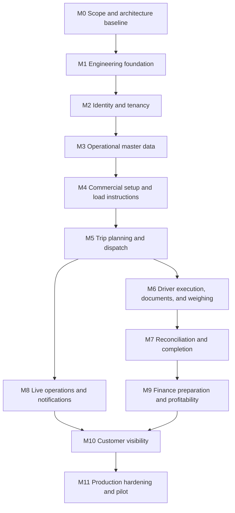

# LoadIx Delivery Milestones

## Delivery Principles

- Deliver vertical, testable capabilities while establishing shared foundations
  only when the next slice needs them.
- Tenant isolation, authorization, audit, concurrency, idempotency, and
  observability are built into each milestone.
- Each milestone must meet the repository definition of done before dependent
  work begins.
- Validate domain policies with representative operators before making
  irreversible model decisions.

## Execution Order

M8 can proceed alongside late M6/M7 work once trip events are stable. Finance must
not start before reconciliation and immutable pricing inputs are defined.

## M0 — Scope and Architecture Baseline

**Outcome:** A shared product vocabulary, architecture direction, engineering
rules, and delivery sequence.

**Deliverables:**

- repository assessment;
- `AGENTS.md` and the initial documentation set;
- recorded decisions, assumptions, open discovery questions, and proposed
  structure; and
- agreed MVP boundary.

**Exit criteria:** Stakeholders confirm the MVP interpretation and identify owners
for unresolved domain, security, finance, and operations decisions.

## M1 — Engineering Foundation

**Outcome:** A runnable, observable, tested skeleton for local development and CI.

**Status:** Implemented and verified on 2026-07-28.

**Deliverables:**

- .NET solution/projects and React/Vite application;
- pinned SDK/runtime and centralized package management;
- formatting, analyzers, nullable references, and warning policy;
- Compose services for SQL Server, Redis, RabbitMQ, MinIO, and required local
  observability;
- configuration validation, Problem Details, OpenAPI, health checks, Serilog, and
  OpenTelemetry baseline;
- EF Core context/migration and Testcontainers test harness;
- architecture-test rules;
- frontend design tokens, application shell, API client generation, and test
  harnesses;
- Dockerfiles, GitHub Actions, `.env.example`, and quick-start README.

**Key tests:** solution build, container health, database migration, API smoke,
architecture boundaries, frontend render/build, and CI reproducibility.

**Decision gates:** MediatR versus native handlers; TanStack Router versus React
Router; telemetry backend; package set.

## M2 — Identity, Tenancy, and Authorization

**Outcome:** Users can authenticate and operate only within explicitly authorized
tenant contexts.

**Status:** Authentication, invitation-based user administration, tenant
authorization, session security, and audited support context implemented and
verified on 2026-07-28. Authentication screens were delivered as the next
requested product milestone even though this roadmap groups the capability under
M2.

**Deliverables:**

- tenant, user, membership, role, and permission model;
- ASP.NET Core Identity flows, invitation/reset policy, JWT access tokens, rotating
  hashed refresh tokens, reuse detection, and revocation;
- trusted tenant-context resolution and tenant-aware persistence controls;
- platform roles and controlled support-access workflow;
- permission policies, audit events, auth rate limits, and secure browser session
  design;
- company/branch settings including currency and time zone.

**Key tests:** two-tenant read/write isolation, guessed IDs, membership switching,
permission denial, refresh rotation/reuse, revoked membership, support access,
and audit immutability.

**Decision gates:** MFA requirements, federation, membership multiplicity,
support/break-glass policy, session storage threat model.

## M3 — Operational Master Data

**Outcome:** Authorized users can maintain the resources needed to plan work.

**Status:** Implemented and verified on 2026-07-28 as the requested Milestone 4
master-data slice. The request numbering is one ahead of this original roadmap
because authentication was delivered separately.

**Deliverables:**

- customers and customer access scope;
- locations and geofences;
- drivers, vehicles, trailers, commodities, status, and availability;
- bounded/filterable/stably sorted lists;
- concurrency controls, indexes, validation, audit events, and synthetic seed data;
- responsive management UI with loading, empty, error, and conflict states.

**Key tests:** tenant/customer scoping, uniqueness within tenant, concurrency
conflicts, validation/local formats, pagination bounds, and stable sorting.

**Decision gates:** compliance-expiry scope, trailer combinations, geofence
shapes, subcontractor inclusion.

## M4 — Contracts and Load Instructions

**Outcome:** Commercial terms can produce controlled requests for transport.

**Status:** Complete. The transport-contract and rate-calculation slice was
implemented on 2026-07-28 as requested Milestone 5. The load-instruction,
quantity-progress, lifecycle, and idempotent trip-generation slice was implemented
as requested Milestone 6.

**Deliverables:**

- effective-dated contracts, lanes, commodities, rates, tolerance definitions,
  and document requirements;
- load-instruction lifecycle and planned quantity;
- immutable/versioned commercial rule handling;
- create/review/list UI and audit history.

**Key tests:** effective-date selection, decimal precision/rounding, invalid
overlaps, authorization, concurrency, instruction quantity rules, and historical
version retention.

**Decision gates:** billable quantity methods, rate types, tolerance algorithms,
multi-stop/split instructions, cancellation/amendment policy.

## M5 — Trip Planning and Dispatch

**Outcome:** Controllers can split instructions into trips, assign resources, and
dispatch eligible work.

**Status:** Implemented as requested Milestone 7. Generated reservations are
promoted to tenant-owned operational trips with immutable rate snapshots,
explicit lifecycle commands, assignment/conflict checks, command idempotency,
concurrency, audit history, and a dispatch workspace.

**Deliverables:**

- trip aggregate and explicit state machine;
- resource assignment/history and eligibility checks;
- instruction fulfillment totals;
- controller trip board/list with dense filtering and keyboard-friendly actions;
- idempotent trip creation and dispatch commands;
- concurrency, audit, and domain events.

**Key tests:** legal/illegal transitions, duplicate commands, conflicting
assignments, concurrent edits, quantity constraints, tenant boundaries, and
permission/state checks.

**Decision gates:** post-dispatch reassignment, rejected/diverted/returned flows,
resource scheduling conflicts.

## M6 — Driver Execution, Documents, and Weighing

**Outcome:** Drivers can execute assigned trips and capture reliable evidence in
intermittent connectivity.

**Current implementation note:** The secure document and proof-of-delivery slice
requested as Milestone 9 is implemented: tenant-scoped metadata, MinIO-compatible
storage, quarantine and validation, fail-closed malware scanning abstraction,
authorized streaming, safe image previews, trip UI, idempotency, audit, and
completed-trip immutability. Offline document queues, driver PWA execution, and
dedicated weighing remain part of the broader M6 work.

**Driver mobile implementation note:** The requested Milestone 10 driver PWA
adds an installable web manifest/service worker, assignment-scoped driver
workspace, mobile controls, IndexedDB command queue, idempotent retry, explicit
sync/conflict state, camera-friendly evidence capture, and permission-gated
location updates. Browser background sync and background tracking remain future
integration decisions rather than simulated capabilities.

**Deliverables:**

- installable responsive driver PWA and minimal assigned-work sync;
- local mutation/document queue with explicit sync and conflict state;
- arrival/departure milestones and optional location observations;
- source/destination gross and tare measurements with net calculation;
- two-phase document upload, quarantine/validation/scanning, POD and weighbridge
  categories, authorized download;
- idempotency, concurrency, audit, and telemetry.

**Key tests:** offline/reconnect, duplicate submission, out-of-order operations,
upload signature/size/type failures, unauthorized document access, measurement
precision, device revocation, and cross-tenant object-key isolation.

**Decision gates:** malware provider, object retention, trusted GPS sources,
offline data lifetime, mandatory evidence rules.

## M7 — Reconciliation and Trip Completion

**Outcome:** Completed movements have reproducible quantity outcomes and controlled
exception resolution.

**Deliverables:**

- source/destination comparison and versioned tolerance evaluation;
- shortage/excess and exception queue;
- review/override workflow with reasons and approvals;
- trip completion eligibility and immutable completion snapshot;
- operational reconciliation UI and audit trail.

**Key tests:** calculation boundaries, units/rounding, tolerance edge cases,
missing evidence, unauthorized override, approval segregation, concurrency, and
historical reproducibility.

**Decision gates:** shortage liability and adjustment rules, four-eyes approval,
correction/reopen policy.

## M8 — Live Operations and Notifications

**Outcome:** Controllers see current operational state and receive actionable
exception signals.

**Deliverables:**

- purpose-built operations read model;
- SignalR tenant-scoped updates with reconnect/refetch behavior;
- status, aging, exception, branch/customer, and assignment filters;
- map view with provider-safe tile usage;
- notification requests/preferences, Hangfire scheduling/retry, and delivery
  outcomes;
- outbox publication and idempotent consumers.

**Key tests:** hub authorization/group isolation, stale reconnect, read-model
eventual consistency, broker/provider outage, notification deduplication, and
time-zone scheduling.

**Decision gates:** channels/providers, escalation rules, SLA thresholds, map
provider/licensing.

## M9 — Profitability and Invoice Preparation

**Outcome:** Finance users can understand estimated trip economics and prepare
approved batches for accounting.

**Deliverables:**

- immutable charge and cost calculations/snapshots;
- profitability views with transparent inputs;
- invoice-ready eligibility and approval;
- invoice-preparation batches, locking, removal/cancellation rules, and
  export/versioned integration payload;
- strong audit and concurrency controls.

**Key tests:** decimal precision, currency and rounding, rule-version
reproducibility, duplicate batch prevention, conflicting approvals, unauthorized
financial access, and export totals.

**Decision gates:** cost components, VAT/accounting treatment, accounting target,
approval segregation, correction/credit workflow. Obtain finance/legal review;
do not represent technical behavior as tax compliance.

## M10 — Customer Visibility

**Outcome:** Customer users see only their authorized shipment information and
documents.

**Deliverables:**

- customer-scoped membership/access model;
- shipment status, milestones, reconciliation-approved quantities, and permitted
  POD views;
- restricted notifications or exports if approved;
- access auditing, rate limits, and privacy-aware presentation.

**Key tests:** customer-to-customer isolation inside one tenant, tenant isolation,
document-category authorization, revoked access, enumeration resistance, and
safe error responses.

**Decision gates:** visible fields/statuses, delay/embargo rules, branding,
anonymous tracking (currently out of scope).

## M11 — Production Hardening and Pilot

**Outcome:** The system is deployable, recoverable, supportable, and validated
with pilot operators.

**Deliverables:**

- threat-model closure and independent security review;
- performance/capacity tests and query/index tuning;
- accessibility and representative-device/low-bandwidth testing;
- backup/restore and disaster-recovery exercise;
- SLOs, dashboards, alerts, runbooks, incident and support-access procedures;
- retention/erasure/legal-hold workflows;
- dependency/container scans, SBOM, deployment automation, rollback strategy;
- pilot onboarding, training, feedback loop, and go-live checklist.

**Key tests:** load/soak, failure recovery, restore verification, tenant isolation
regression, authorization matrix, offline endurance, browser/device compatibility,
and operational drills.

**Decision gates:** hosting topology, RPO/RTO, availability targets, regional data
requirements, support model, legal/privacy sign-off.

## Cross-Cutting Work in Every Milestone

- schema migrations and realistic synthetic seed updates;
- OpenAPI and generated client consistency;
- tenant and permission tests;
- immutable audit coverage for sensitive actions;
- telemetry, health implications, and safe logging;
- accessible responsive states;
- documentation and operational notes;
- package justification and security review; and
- format, build, unit, integration, architecture, component, E2E, and Compose
  checks proportional to the change.

## Risks to Track

| Risk | Early mitigation |
| --- | --- |
| Domain variation between mining, agriculture, and construction | Validate one pilot workflow first; version policies rather than hard-code |
| Tenant data leakage | Layered tenant controls and adversarial two-tenant integration tests |
| Offline duplicate/conflicting actions | Idempotency, concurrency, explicit sync state, narrow offline data |
| Weight/rate disputes | Immutable inputs, policy versions, evidence, transparent calculation audit |
| Upload malware or data exposure | Quarantine, signature/size checks, scanning, opaque keys, authorized download |
| Infrastructure complexity too early | Keep one deployable and clear responsibilities; make optional systems non-critical |
| Finance scope expansion | Maintain invoice-preparation boundary until accounting requirements are approved |
| Public OSM tile misuse | Select a compliant map provider/cache policy before production |
| POPIA expectations mistaken for compliance | Legal/process review alongside technical privacy controls |
